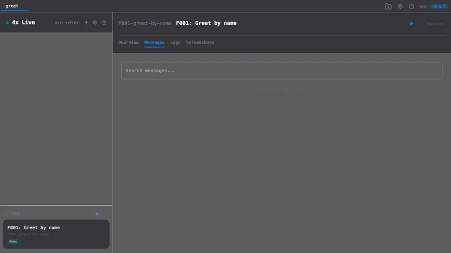
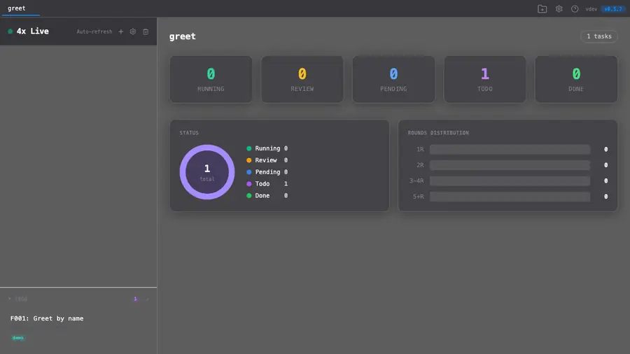

<div align="center">

<picture>
  <source media="(prefers-color-scheme: dark)" srcset="docs/assets/banner-dark.svg">
  
</picture>

**An agentic development loop that splits Design, Code, Review and Test into isolated AI roles, held in check by deterministic guardrails.**

<p>
  <a href="https://github.com/ggwhite/4x/actions/workflows/ci.yml"></a>
  <a href="https://github.com/ggwhite/4x/releases"></a>
  <a href="https://pkg.go.dev/github.com/ggwhite/4x"></a>
  <a href="https://goreportcard.com/report/github.com/ggwhite/4x"></a>
  <a href="LICENSE"></a>
  
</p>

[Install](#install) · [Quick start](#quick-start) · [Features](#features) · [How the loop works](#how-the-loop-works) · [Guardrails](#deterministic-guardrails) · [Architecture](#architecture) · [Docs](#documentation) · [FAQ](#faq)

**English** | [繁體中文](docs/translate/README.zh-TW.md) | [简体中文](docs/translate/README.zh-CN.md) | [日本語](docs/translate/README.ja.md) | [한국어](docs/translate/README.ko.md) | [Español](docs/translate/README.es.md)

</div>

---

<div align="center">
  <a href="docs/assets/tour.mp4"></a>
  <br>
  <sub>▶ <a href="docs/assets/tour.mp4">Watch the full tour</a> · one real Claude Code run (about 4 minutes, $2), agent waits cut short</sub>
</div>

## Why

Single-agent coding is fast but fragile. You ask one AI to design, implement, review and test, all in the same breath and with the same biases. It works for small tasks. It falls apart on real features.

4x splits the loop. Each role has a focused job, limited scope and no access to the others' reasoning: the Designer doesn't write code, the Coder doesn't judge its own work, the Reviewer is adversarial by design, and the Tester validates against criteria written before implementation. The Go CLI, not an LLM, decides what may happen next. Like 4X strategy games (eXplore, eXpand, eXploit, eXterminate), distinct roles with distinct strengths converge on one goal: features that survive contact with production.

## Features

<table>
<tr>
<td width="42%" valign="middle">

### Four isolated roles

**Designer → Coder → Reviewer → Tester → Accept**, each a separate runner process that only talks through files in `.4x/`. A Reviewer **FAIL** or failed verification sends the code to **amending**; a wrong spec **escalates** back to the Designer. Pipeline **profiles** (`full`, `normal`, `lite`, `quick` or your own) pick which phases run.

</td>
<td></td>
</tr>
<tr>
<td width="42%" valign="middle">

### Deterministic guardrails

Guardrails are **Go code, not prompts**. `4x check` verifies **scope**, the **baseline** snapshot, required files and **verify evidence**; the **state machine** rejects illegal phase jumps; `4x verify` only runs commands on the project's **allowlist**. A runner cannot talk its way past any of them.

</td>
<td></td>
</tr>
<tr>
<td width="42%" valign="middle">

### 4x Live dashboard

`4x live` serves a **multi-project dashboard** over REST + **SSE**: feature cards move from Todo to Running to Review as phases change, with rounds, runner and cost per feature. The same web UI is embedded in the binary and wrapped by the **macOS (Swift)** and **Windows / Linux (Tauri)** apps.

</td>
<td></td>
</tr>
<tr>
<td width="42%" valign="middle">

### Cost per role and round

Every runner call is logged with its model, duration and **USD cost or tokens**. `4x cost` aggregates them **per role**, `--by-round` shows how much went into **retries**, and `--feature` breaks one feature down round by round, so you can see what a review failure actually cost.

</td>
<td></td>
</tr>
</table>

### More

- **7 runners**: Claude Code, Codex, Gemini CLI, Antigravity, Copilot, Cursor and OpenCode share the same `.4x/` file protocol. Mix them per role or per phase (`--phase-override`).
- **Adaptive pipeline**: a profile advisor suggests `full` / `normal` / `quick` from feature complexity; per-role models use `strong` / `fast` tiers.
- **Crash recovery**: a runner crash resumes from the last saved state; transient API errors (network, rate limits) retry with backoff.
- **Human sign-off**: every feature stops at `pending-review`; `4x done` marks it done and merges its branch (or, with `issue_tracker`, opens the PR/MR).
- **Issue-first MR flow**: optional `issue_tracker` mode. `4x new` creates or links an issue, `4x done` pushes the branch and opens a PR/MR instead of merging locally. GitHub vs. GitLab (including self-hosted) is detected from each repo's remote.
- **Dependencies**: `4x new --depends F001` gates a feature until its dependencies are done; the dashboard draws the dependency graph.
- **Self-evolution**: `4x mine` / `4x gate` / `4x evolve` mine past runs for failure signals, filter candidates through a value gate and enqueue improvement features. Retro learnings (`4x learn`) are injected into later role prompts.
- **MCP server** and **Claude Code skills** (`4x-audit`, `4x-autopilot`), see below.
- **30+ CLI commands**: `run`, `status`, `check`, `verify`, `retry`, `cost`, `live`, `doctor`, `clean`, `mcp`, `skills`, phase hooks, structured logging and more. See the [CLI reference](docs/guide/cli.md).

## Install

### Homebrew (macOS / Linux)

```bash
brew install ggwhite/tap/fourx
```

### Go install

```bash
go install github.com/ggwhite/4x/cmd/4x@latest
```

### Shell script

```bash
curl -sSfL https://raw.githubusercontent.com/ggwhite/4x/main/install.sh | sh
```

### Download binary

Pre-built binaries for macOS, Linux and Windows (amd64 / arm64) are on the [Releases](https://github.com/ggwhite/4x/releases) page.

<details>
<summary><b>Verify checksums</b> (manual downloads)</summary>

The shell script verifies the download's checksum automatically and aborts if it fails. When downloading a release archive or binary manually from the [Releases](https://github.com/ggwhite/4x/releases) page, verify it yourself before extracting: download that release's `checksums.txt` into the same directory, then run one of:

```bash
# Linux (and macOS with coreutils)
sha256sum --check --ignore-missing checksums.txt

# macOS (default)
shasum -a 256 --ignore-missing --check checksums.txt
```

Only extract and run the binary once the checksum reports `OK`.

</details>

## Quick start

```bash
# Initialize in your project
cd my-project
4x init

# Create a feature
4x new "User authentication with OAuth2"
# => Created feature: F001-user-authentication (User authentication with OAuth2)

# Run the full loop
4x run F001 --runner claude

# Check status
4x status

# Review and complete
4x done F001

# Or watch it live
4x live -w
```

`4x run` drives the Design-Code-Review-Test loop automatically. If Review finds issues, Code gets another pass. If Test fails, the loop iterates. You stay in control with `--max-rounds`, `--profile` and `--timeout`.

## The four roles

| Role | Job | Outputs |
|---|---|---|
| **Designer** | Analyze requirements, produce spec + acceptance criteria | `task-brief.md`, `acceptance-criteria.md`, `test-strategy.yaml` |
| **Coder** | Implement exactly what the spec says | Source code, `coder-report.md` |
| **Reviewer** | Catch bugs and spec violations (checklist + adversarial) | `review-report.md` with verdict |
| **Tester** | Validate against acceptance criteria with evidence | `test-report.md`, `verify.json` |

Each role is **isolated**. The Coder never sees the Reviewer's prior feedback. The Tester validates against criteria written by the Designer, not the Coder. This separation prevents the blind spots that plague single-agent workflows. The `full` profile adds a Design Reviewer, a multi-angle Deep Reviewer, a Fixer and an Acceptor around the four core roles.

## How the loop works

<picture>
  <source media="(prefers-color-scheme: dark)" srcset="docs/assets/loop-dark.svg">
  
</picture>

- **Review failure** (verdict FAIL or CRITICAL findings) sends code back for amending
- **Test failure** (verify not passed) sends code back for amending
- **Escalation** (spec mismatch, criteria wrong) routes back to Designer
- **Pending review** gate ensures a human always reviews before marking done
- **Round budget** (default 5) prevents infinite loops

The legal transitions live in [`internal/state/machine.go`](internal/state/machine.go); see [Core Concepts](docs/guide/concepts.md) for the full state machine.

## Deterministic guardrails

Enforced by the CLI, not AI judgment:

| Guardrail | What it does |
|---|---|
| **Scope check** | Changed files must be within declared repos |
| **Baseline snapshot** | Pre-coding state captured for safe rollback |
| **State machine** | Phases must proceed in legal order |
| **Evidence requirement** | Tester must provide `verify.json` with command output |
| **Testing gate** | `verify.json` + test report + final report required |
| **Verify allowlist** | `4x verify` only runs commands listed in `verify_command_allowlist` |
| **Dependency gate** | Features with unmet dependencies cannot start |

## Architecture

<picture>
  <source media="(prefers-color-scheme: dark)" srcset="docs/assets/architecture-dark.svg">
  
</picture>

**Layer 1: CLI** handles everything deterministic: scope validation, state transitions, baseline snapshots, evidence collection. It never calls an LLM, so guardrails don't depend on AI judgment.

**Layer 2: Runners** bridge the CLI protocol to your AI tool of choice. Each speaks the same `.4x/` file protocol but uses its native platform capabilities.

**Layer 3: Live** is the multi-project dashboard. Watch your agents work in real time, see phase transitions, stream logs. REST + SSE API.

## Autopilot

Queue several features (use `--depends` to order them), then let the `4x-autopilot` Claude Code skill drive them: it picks the next eligible feature, runs it, signs it off, merges and moves on, unattended. It replaces the former `4x batch` command.

## MCP server

`4x mcp` starts a Model Context Protocol server over stdio. It exposes the CLI to MCP clients as tools such as `4x_status`, `4x_new`, `4x_run`, `4x_stop`, `4x_check`, `4x_verify`, `4x_done`, `4x_doctor` and `4x_learn_*`.

```bash
4x mcp
```

## Claude Code skills

4x ships two optional [Claude Code Skills](https://docs.anthropic.com/en/docs/claude-code) for driving the pipeline from a Claude Code session. Install them with [`npx skills`](https://github.com/vercel-labs/skills), no need to clone this repo:

```bash
npx skills add ggwhite/4x --skill 4x-audit       # scan past run artifacts, report + optionally file gap features
npx skills add ggwhite/4x --skill 4x-autopilot   # drive the full pick → run → merge → next loop unattended
npx skills add ggwhite/4x --all                  # install both
```

- **`4x-audit`**: scans discovered-feature-gaps, escalation/review reports and recurring learnings patterns; produces a categorized HTML report and can optionally batch-create feature YAMLs.
- **`4x-autopilot`**: polls 4x state and drives features through their full lifecycle (design → code → review → test → merge) without pausing for confirmation, including merging. **Owner-only**: read the skill's warning before using it on a shared repo.

From a clone of this repo, `4x skills install <name>` symlinks a skill into `~/.claude/skills/` instead.

## Permission model

> [!WARNING]
> **4x runs AI agents in non-interactive mode.** Run 4x only in projects where you are comfortable with autonomous AI agent execution.

<details>
<summary>What that means</summary>

During `4x init`, runners are configured with flags that skip permission prompts (`--dangerously-skip-permissions`, `-y`, `--yolo`) so the loop runs autonomously.

The CLI's deterministic guardrails (scope lock, baseline snapshots, state machine, verify allowlist) provide the safety boundary. Before a runner is spawned, 4x also filters sensitive environment variables (`*_TOKEN`, `*_KEY`, `*_SECRET`, `AWS_*`, ...) out of its environment; see [Runners & Plugins](docs/guide/runners.md).

</details>

## Trade-offs

Choosing 4x means trading speed and cost for structure and correctness. Be honest about whether your project needs that trade.

<details>
<summary><b>Strengths, weaknesses, and when (not) to use 4x</b></summary>

### Strengths

- **Role isolation eliminates self-review bias.** The Coder never judges its own work. The Reviewer is adversarial by design. Single-agent workflows let the same model write and approve code; 4x doesn't.
- **Deterministic guardrails don't depend on AI judgment.** Scope lock, state machine, evidence requirements: these are enforced by the CLI in Go, not by prompting an LLM to "please stay in scope."
- **File-based protocol makes it LLM-agnostic.** Switch between Claude, Gemini, Codex, or mix them per role. No vendor lock-in, no SDK dependency.
- **Crash-resistant state.** Everything lives in `.4x/` files. Session dies, machine reboots: `4x run` picks up exactly where it stopped.
- **Human stays in the loop.** The `pending-review` gate ensures a human always reviews AI work before it's marked done. The AI proposes, you dispose.
- **Tames large-scale refactoring.** Changes too big for a single AI session (splitting god objects, extracting packages, migrating APIs) can be broken into dependent features with appropriate profiles. 4x handles the sequencing, review and verification across multiple phases that would overwhelm a single context window.
- **Scales to a backlog.** Dependencies plus the autopilot skill let you queue dozens of features overnight and review them in the morning.

### Weaknesses

- **Significantly higher token cost.** Every feature runs through 4+ separate LLM calls at minimum. A review failure doubles that. Expect 3-10x the token cost of a single-agent approach for the same task. See [Usage Tips](docs/guide/usage-tips.md) for cost estimates.
- **Slower for simple tasks.** A one-line bug fix doesn't need a Designer, Reviewer and Tester. The overhead of the full loop is wasted on trivial changes. Use single-agent tools for quick fixes.
- **Setup cost.** `4x init`, feature YAML, settings configuration: there's ceremony before you start. Not worth it for a throwaway script.
- **Rigid loop structure.** The Design → Code → Review → Test sequence is fixed. If your workflow doesn't fit four roles, you'll fight the framework instead of using it.
- **Quality depends on prompt quality.** Vague feature descriptions produce vague specs, which produce wrong code. 4x adds structure, but garbage in still means garbage out, just with more steps.

### When to use 4x

- Features that need to be correct (payments, auth, data pipelines)
- Work that benefits from adversarial review (security-sensitive code)
- Working through a feature backlog
- Teams that want audit trails of AI-generated code

### When NOT to use 4x

- Quick one-off fixes or exploratory prototyping
- Tasks where speed matters more than correctness
- Projects where token budget is tight
- Solo hacking sessions where you'd review the code yourself anyway

</details>

## Documentation

| Document | Description |
|---|---|
| **[User Guide](docs/guide/)** | Complete usage documentation |
| [Getting Started](docs/guide/getting-started.md) | Installation and first run |
| [CLI Reference](docs/guide/cli.md) | All commands and flags |
| [Core Concepts](docs/guide/concepts.md) | Roles, state machine, protocol, guardrails |
| [Configuration](docs/guide/configuration.md) | Settings, models, locale, runners |
| [Runners & Plugins](docs/guide/runners.md) | Supported runners and plugin contract |
| [Dashboard](docs/guide/dashboard.md) | 4x Live multi-project dashboard |
| [Usage Tips](docs/guide/usage-tips.md) | Model choice, cost, troubleshooting |

<details>
<summary><b>Project structure</b></summary>

```
4x/
  cmd/4x/              CLI entry point (Cobra), one file per subcommand
  internal/
    protocol/           .4x/ file format, workspace, types
    state/              State machine (phase transitions)
    guard/              Guardrail checks (scope, baseline, evidence)
    orchestrator/       Run loop orchestration
    runner/             Subprocess runner interface
    server/             SSE + REST server for Live dashboard
    mcp/                MCP server (stdio)
  plugins/
    claude-code/        Claude Code runner instructions
    codex/              Codex runner instructions
    gemini/             Gemini runner instructions
    agy/                Antigravity runner instructions
    copilot/            Copilot runner instructions
    cursor/             Cursor rules
    opencode/           OpenCode runner instructions
    embed.go            go:embed plugin files into binary
  dashboard/
    web/                Dashboard UI, embedded into the binary
    macos/              Swift native app
    tauri/              Windows / Linux app
  skills/               4x-audit, 4x-autopilot Claude Code skills
  templates/            Role prompt templates
  docs/
    guide/              User documentation
    architecture/       System-level design docs
    design/             Mechanism design docs
    reference/          Plugin contract
```

</details>

## FAQ

<details>
<summary><b>Does 4x call any LLM APIs directly?</b></summary>

No. The CLI is pure Go with zero LLM dependencies. Runners handle all AI interaction using their native platform capabilities.

</details>

<details>
<summary><b>Can I use different LLMs for different roles?</b></summary>

Yes. Configure per-role models in `.4x/settings.json`. Use Claude for Design, Gemini for Code: each reads the same `.4x/` files.

</details>

<details>
<summary><b>How is this different from Devin / SWE-agent / OpenHands?</b></summary>

Those are autonomous agents that do everything in one shot. 4x is a *framework* that structures multi-role collaboration with deterministic guardrails. It's closer to a CI pipeline for AI than a single autonomous agent.

</details>

## Development

```bash
git clone https://github.com/ggwhite/4x.git
cd 4x
make build      # bin/4x
make test       # go test -race ./...
make lint       # go vet + gofmt + golangci-lint
```

See [CONTRIBUTING.md](CONTRIBUTING.md) for the full workflow.

<details>
<summary><b>Re-recording the README clips and diagrams</b></summary>

All clips come from the real binary, built from source, in a throwaway project and `HOME` under `/tmp/4xdemo`. Recording is headless: [`vhs`](https://github.com/charmbracelet/vhs) for the terminal, Python Playwright (headless Chromium) for the dashboard. Needs `vhs`, `ffmpeg`, `img2webp` (libwebp), Python `playwright` and, for the tour, a logged-in `claude` CLI.

```bash
docs/assets/record/render.sh tour      # fresh /tmp/4xdemo, ONE real 4x run (about $2 of tokens), all clips
docs/assets/record/render.sh recut     # re-encode the clips from the last run's frames, no agent run
python3 docs/assets/diagrams/gen.py    # architecture / loop SVGs (light + dark)
python3 docs/assets/diagrams/snapshot.py /tmp/svg docs/assets/*-light.svg   # check frames + reduced motion
```

`render.sh tour` runs [`setup-demo.sh`](docs/assets/record/setup-demo.sh) (builds 4x from source, creates a tiny Go project "greet"), records [`tour.tape`](docs/assets/record/tour.tape) while [`capture-live.py`](docs/assets/record/capture-live.py) screenshots `4x live`, records the feature clips, then [`tour-end.tape`](docs/assets/record/tour-end.tape) signs the feature off. [`retime.py`](docs/assets/record/retime.py) cuts the long agent waits and encodes WebP with `img2webp`. The Claude Code runner is called through a wrapper that skips user settings, hooks, plugins and MCP servers.

Before committing new clips, OCR every frame (`swiftc docs/assets/record/ocr.swift -o /tmp/ocr`, then `magick clip.webp -coalesce f-%03d.png` and `/tmp/ocr f-*.png`) and grep the text for user names, hostnames, emails and tokens.

</details>

## Origin story

4x was born inside a production system called DCT (Designer-Coder-Tester) that shipped 60+ features for a large-scale platform rewrite. The patterns that survived (role isolation, file-based protocol, deterministic scope checking, evidence-based testing) became 4x. The parts that didn't (LLM-specific hacks, shared context assumptions, trust-based guardrails) were deliberately left out.

## License

[MIT](LICENSE)

---

<p align="center">
  <strong>Stop hoping your AI writes correct code. Start verifying it.</strong>
</p>
