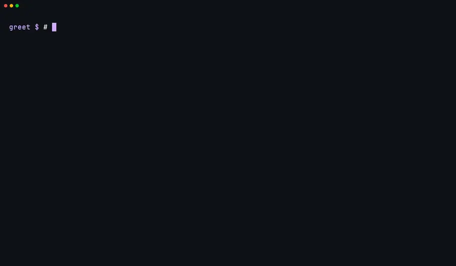

<div align="center">

<picture>
  <source media="(prefers-color-scheme: dark)" srcset="../assets/banner-dark.svg">
  
</picture>

**Design, Code, Review, Test를 서로 격리된 AI 역할로 나누고, 결정론적 가드레일로 통제하는 에이전트형 개발 루프.**

<p>
  <a href="https://github.com/ggwhite/4x/actions/workflows/ci.yml"></a>
  <a href="https://github.com/ggwhite/4x/releases"></a>
  <a href="https://pkg.go.dev/github.com/ggwhite/4x"></a>
  <a href="https://goreportcard.com/report/github.com/ggwhite/4x"></a>
  <a href="../../LICENSE"></a>
  
</p>

[설치](#설치) · [빠른 시작](#빠른-시작) · [기능](#기능) · [루프 동작 방식](#루프-동작-방식) · [가드레일](#결정론적-가드레일) · [아키텍처](#아키텍처) · [문서](#문서) · [FAQ](#faq)

[English](../../README.md) | [繁體中文](README.zh-TW.md) | [简体中文](README.zh-CN.md) | [日本語](README.ja.md) | **한국어** | [Español](README.es.md)

</div>

---

<div align="center">
  <a href="../assets/tour.mp4"></a>
  <br>
  <sub>▶ <a href="../assets/tour.mp4">전체 투어 보기</a> · 실제 Claude Code 실행 한 번(약 4분, $2), 에이전트 대기 시간은 줄임</sub>
</div>

## 왜 4x인가

단일 에이전트 코딩은 빠르지만 취약하다. AI 하나에게 설계, 구현, 리뷰, 테스트를 한 호흡에 같은 편향을 가진 채로 맡기는 셈이다. 작은 작업에는 통하지만 실제 기능 개발에서는 무너진다.

4x는 이 루프를 쪼갠다. 각 역할은 맡은 일이 분명하고 범위가 제한되며, 다른 역할의 추론에 접근할 수 없다. Designer는 코드를 쓰지 않고, Coder는 자기 작업을 평가하지 않으며, Reviewer는 의도적으로 적대적이고, Tester는 구현 전에 작성된 기준으로 검증한다. 다음에 무엇이 일어날 수 있는지는 LLM이 아니라 Go CLI가 결정한다. 4X 전략 게임(eXplore, eXpand, eXploit, eXterminate)처럼, 서로 다른 강점을 가진 역할들이 하나의 목표로 수렴한다. 바로 프로덕션에서 살아남는 기능이다.

## 기능

<table>
<tr>
<td width="42%" valign="middle">

### 격리된 네 가지 역할

**Designer → Coder → Reviewer → Tester → Accept**, 각 역할은 별도의 runner 프로세스이며 `.4x/` 안의 파일로만 소통한다. Reviewer의 **FAIL**이나 검증 실패는 코드를 **amending**으로 보내고, 잘못된 스펙은 Designer에게 **에스컬레이션**된다. 파이프라인 **profile**(`full`, `normal`, `lite`, `quick` 또는 직접 정의)로 실행할 단계를 고른다.

</td>
<td></td>
</tr>
<tr>
<td width="42%" valign="middle">

### 결정론적 가드레일

가드레일은 **프롬프트가 아니라 Go 코드**다. `4x check`는 **scope**, **baseline** 스냅샷, 필수 파일, **verify 증거**를 검사하고, **상태 머신**은 불법적인 단계 이동을 거부하며, `4x verify`는 프로젝트 **허용 목록**에 있는 명령만 실행한다. runner가 말로 이를 우회할 수는 없다.

</td>
<td></td>
</tr>
<tr>
<td width="42%" valign="middle">

### 4x Live 대시보드

`4x live`는 REST + **SSE**로 **멀티 프로젝트 대시보드**를 제공한다. 단계가 바뀌면 feature 카드가 Todo에서 Running, Review로 이동하고, feature별 라운드, runner, 비용이 표시된다. 같은 웹 UI가 바이너리에 내장되어 있으며 **macOS**(Swift)와 **Windows / Linux**(Tauri) 앱으로도 감싸져 있다.

</td>
<td></td>
</tr>
<tr>
<td width="42%" valign="middle">

### 역할별·라운드별 비용

모든 runner 호출은 모델, 소요 시간, **USD 비용 또는 토큰 수**와 함께 기록된다. `4x cost`는 **역할별**로 집계하고, `--by-round`는 **재시도**에 얼마가 들었는지 보여 주며, `--feature`는 한 feature를 라운드별로 쪼개어 리뷰 실패가 실제로 얼마의 비용을 냈는지 확인할 수 있게 한다.

</td>
<td></td>
</tr>
</table>

### 그 밖의 기능

- **7가지 runner**: Claude Code, Codex, Gemini CLI, Antigravity, Copilot, Cursor, OpenCode가 같은 `.4x/` 파일 프로토콜을 공유한다. 역할별 또는 단계별로 섞어 쓸 수 있다(`--phase-override`).
- **적응형 파이프라인**: profile 어드바이저가 feature 복잡도에 따라 `full` / `normal` / `quick`을 제안한다. 역할별 모델은 `strong` / `fast` 두 등급을 쓴다.
- **크래시 복구**: runner가 죽어도 마지막으로 저장된 상태에서 재개한다. 일시적인 API 오류(네트워크, rate limit)는 백오프와 함께 재시도한다.
- **사람의 최종 승인**: 모든 feature는 `pending-review`에서 멈춘다. `4x done`이 완료 처리하고 브랜치를 병합한다(`issue_tracker`를 쓰면 PR/MR을 연다).
- **Issue 우선 MR 흐름**: 선택 사항인 `issue_tracker` 모드. `4x new`가 issue를 만들거나 연결하고, `4x done`은 로컬 병합 대신 브랜치를 push하고 PR/MR을 연다. GitHub인지 GitLab(셀프 호스팅 포함)인지는 각 저장소의 remote로 판단한다.
- **의존성**: `4x new --depends F001`은 의존 대상이 완료될 때까지 feature 시작을 막는다. 대시보드는 의존성 그래프를 그린다.
- **자기 진화**: `4x mine` / `4x gate` / `4x evolve`가 지난 실행에서 실패 신호를 캐내고, 가치 게이트로 후보를 거른 뒤 개선용 feature를 큐에 넣는다. 회고에서 얻은 교훈(`4x learn`)은 이후 역할 프롬프트에 주입된다.
- **MCP 서버**와 **Claude Code 스킬**(`4x-audit`, `4x-autopilot`), 아래 참고.
- **30개 이상의 CLI 명령**: `run`, `status`, `check`, `verify`, `retry`, `cost`, `live`, `doctor`, `clean`, `mcp`, `skills`, 단계 훅, 구조화 로깅 등. [CLI 레퍼런스](../guide/ko/cli.md) 참고.

## 설치

### Homebrew (macOS / Linux)

```bash
brew install ggwhite/tap/fourx
```

### Go install

```bash
go install github.com/ggwhite/4x/cmd/4x@latest
```

### 셸 스크립트

```bash
curl -sSfL https://raw.githubusercontent.com/ggwhite/4x/main/install.sh | sh
```

### 바이너리 다운로드

macOS, Linux, Windows(amd64 / arm64)용 사전 빌드 바이너리는 [Releases](https://github.com/ggwhite/4x/releases) 페이지에 있다.

<details>
<summary><b>체크섬 검증</b> (수동 다운로드 시)</summary>

셸 스크립트는 다운로드한 파일의 체크섬을 자동으로 검증하고, 실패하면 중단한다. [Releases](https://github.com/ggwhite/4x/releases) 페이지에서 아카이브나 바이너리를 직접 내려받았다면 압축을 풀기 전에 직접 검증하자. 해당 릴리스의 `checksums.txt`를 같은 디렉터리에 내려받은 뒤 다음 중 하나를 실행한다:

```bash
# Linux (and macOS with coreutils)
sha256sum --check --ignore-missing checksums.txt

# macOS (default)
shasum -a 256 --ignore-missing --check checksums.txt
```

체크섬이 `OK`로 나온 뒤에만 바이너리의 압축을 풀고 실행하자.

</details>

## 빠른 시작

```bash
# Initialize in your project
cd my-project
4x init

# Create a feature
4x new "User authentication with OAuth2"
# => Created feature: F001-user-authentication (User authentication with OAuth2)

# Run the full loop
4x run F001 --runner claude

# Check status
4x status

# Review and complete
4x done F001

# Or watch it live
4x live -w
```

`4x run`은 Design-Code-Review-Test 루프를 자동으로 돌린다. Review에서 문제가 나오면 Code가 한 번 더 돌고, Test가 실패하면 루프가 반복된다. `--max-rounds`, `--profile`, `--timeout`으로 통제권은 여전히 당신에게 있다.

## 네 가지 역할

| 역할 | 하는 일 | 산출물 |
|---|---|---|
| **Designer** | 요구 사항을 분석해 스펙과 인수 기준을 만든다 | `task-brief.md`, `acceptance-criteria.md`, `test-strategy.yaml` |
| **Coder** | 스펙이 말하는 그대로 구현한다 | 소스 코드, `coder-report.md` |
| **Reviewer** | 버그와 스펙 위반을 잡아낸다(체크리스트 + 적대적 리뷰) | 판정이 담긴 `review-report.md` |
| **Tester** | 인수 기준에 맞춰 증거와 함께 검증한다 | `test-report.md`, `verify.json` |

각 역할은 **격리**되어 있다. Coder는 Reviewer의 이전 피드백을 보지 않는다. Tester는 Coder가 아니라 Designer가 쓴 기준으로 검증한다. 이런 분리가 단일 에이전트 워크플로를 괴롭히는 사각지대를 막는다. `full` profile은 네 가지 핵심 역할 주위에 Design Reviewer, 다각도 Deep Reviewer, Fixer, Acceptor를 더한다.

## 루프 동작 방식

<picture>
  <source media="(prefers-color-scheme: dark)" srcset="../assets/loop-dark.svg">
  
</picture>

- **리뷰 실패**(판정 FAIL 또는 CRITICAL 지적)는 코드를 amending으로 돌려보낸다
- **테스트 실패**(verify 미통과)는 코드를 amending으로 돌려보낸다
- **에스컬레이션**(스펙 불일치, 기준 오류)은 Designer로 돌아간다
- **Pending review** 게이트가 완료 처리 전에 반드시 사람이 리뷰하도록 보장한다
- **라운드 예산**(기본값 5)이 무한 루프를 막는다

허용되는 전이는 [`internal/state/machine.go`](../../internal/state/machine.go)에 정의되어 있다. 전체 상태 머신은 [핵심 개념](../guide/ko/concepts.md)을 참고하자.

## 결정론적 가드레일

AI의 판단이 아니라 CLI가 강제한다:

| 가드레일 | 역할 |
|---|---|
| **스코프 검사** | 변경된 파일은 선언된 저장소 안에 있어야 한다 |
| **베이스라인 스냅샷** | 안전한 롤백을 위해 코딩 전 상태를 저장한다 |
| **상태 머신** | 단계는 허용된 순서로만 진행된다 |
| **증거 요구** | Tester는 명령 출력이 담긴 `verify.json`을 제출해야 한다 |
| **테스트 게이트** | `verify.json` + 테스트 보고서 + 최종 보고서가 필요하다 |
| **verify 허용 목록** | `4x verify`는 `verify_command_allowlist`에 있는 명령만 실행한다 |
| **의존성 게이트** | 의존성이 충족되지 않은 feature는 시작할 수 없다 |

## 아키텍처

<picture>
  <source media="(prefers-color-scheme: dark)" srcset="../assets/architecture-dark.svg">
  
</picture>

**레이어 1: CLI**는 결정론적인 일을 모두 처리한다. 스코프 검증, 상태 전이, 베이스라인 스냅샷, 증거 수집. LLM을 절대 호출하지 않으므로 가드레일이 AI의 판단에 의존하지 않는다.

**레이어 2: Runner**는 CLI 프로토콜을 당신이 고른 AI 도구와 연결한다. 모든 runner가 같은 `.4x/` 파일 프로토콜을 쓰지만, 각자 플랫폼 고유의 기능을 활용한다.

**레이어 3: Live**는 멀티 프로젝트 대시보드다. 에이전트가 일하는 모습을 실시간으로 보고, 단계 전이를 확인하고, 로그를 스트리밍한다. REST + SSE API.

## Autopilot

여러 feature를 큐에 넣고(순서는 `--depends`로 지정), Claude Code 스킬 `4x-autopilot`에게 맡기자. 다음으로 실행 가능한 feature를 골라 실행하고, 승인하고, 병합한 뒤 다음으로 넘어간다. 모두 무인으로 진행된다. 이전의 `4x batch` 명령을 대체한다.

## MCP 서버

`4x mcp`는 stdio 위에서 Model Context Protocol 서버를 시작한다. CLI를 `4x_status`, `4x_new`, `4x_run`, `4x_stop`, `4x_check`, `4x_verify`, `4x_done`, `4x_doctor`, `4x_learn_*` 같은 도구로 MCP 클라이언트에 노출한다.

```bash
4x mcp
```

## Claude Code 스킬

4x에는 Claude Code 세션에서 파이프라인을 구동하기 위한 선택 사항 [Claude Code Skills](https://docs.anthropic.com/en/docs/claude-code) 두 개가 함께 제공된다. [`npx skills`](https://github.com/vercel-labs/skills)로 설치하면 되고, 이 저장소를 clone할 필요는 없다:

```bash
npx skills add ggwhite/4x --skill 4x-audit       # scan past run artifacts, report + optionally file gap features
npx skills add ggwhite/4x --skill 4x-autopilot   # drive the full pick → run → merge → next loop unattended
npx skills add ggwhite/4x --all                  # install both
```

- **`4x-audit`**: discovered-feature-gaps, 에스컬레이션/리뷰 보고서, 반복되는 learnings 패턴을 스캔해 분류된 HTML 보고서를 만든다. 필요하면 feature YAML을 일괄 생성할 수도 있다.
- **`4x-autopilot`**: 4x 상태를 폴링하며 feature를 전체 생명 주기(design → code → review → test → merge)에 걸쳐 확인 없이 진행시킨다. 병합까지 포함한다. **소유자 전용**: 공유 저장소에서 쓰기 전에 스킬의 경고를 꼭 읽자.

이 저장소를 clone했다면 대신 `4x skills install <name>`으로 스킬을 `~/.claude/skills/`에 심볼릭 링크할 수 있다.

## 권한 모델

> [!WARNING]
> **4x는 AI 에이전트를 비대화형 모드로 실행한다.** AI 에이전트의 자율 실행을 받아들일 수 있는 프로젝트에서만 4x를 사용하자.

<details>
<summary>이것이 의미하는 것</summary>

`4x init` 시 루프가 자율적으로 돌 수 있도록 runner에는 권한 확인을 건너뛰는 플래그(`--dangerously-skip-permissions`, `-y`, `--yolo`)가 설정된다.

안전 경계는 CLI의 결정론적 가드레일(스코프 잠금, 베이스라인 스냅샷, 상태 머신, verify 허용 목록)이 제공한다. runner를 띄우기 전에 4x는 민감한 환경 변수(`*_TOKEN`, `*_KEY`, `*_SECRET`, `AWS_*` 등)를 환경에서 걸러낸다. [Runner와 플러그인](../guide/ko/runners.md)을 참고하자.

</details>

## 트레이드오프

4x를 고른다는 것은 속도와 비용을 구조와 정확성과 맞바꾼다는 뜻이다. 당신의 프로젝트에 그 거래가 필요한지 솔직하게 판단하자.

<details>
<summary><b>강점, 약점, 그리고 4x를 써야 할 때(와 쓰지 말아야 할 때)</b></summary>

### 강점

- **역할 격리가 셀프 리뷰 편향을 없앤다.** Coder는 자기 작업을 평가하지 않는다. Reviewer는 의도적으로 적대적이다. 단일 에이전트 워크플로에서는 같은 모델이 코드를 쓰고 승인하지만, 4x는 그렇지 않다.
- **결정론적 가드레일은 AI의 판단에 의존하지 않는다.** 스코프 잠금, 상태 머신, 증거 요구. 이것들은 LLM에게 "범위를 지켜 주세요"라고 프롬프트로 부탁하는 것이 아니라 Go로 작성된 CLI가 강제한다.
- **파일 기반 프로토콜이라 LLM에 종속되지 않는다.** Claude, Gemini, Codex를 오가거나 역할별로 섞어 쓸 수 있다. 벤더 종속도, SDK 의존성도 없다.
- **크래시에 강한 상태.** 모든 것이 `.4x/` 파일에 있다. 세션이 죽어도, 머신이 재부팅되어도 `4x run`은 멈춘 지점에서 정확히 이어 간다.
- **사람이 루프 안에 남는다.** `pending-review` 게이트는 AI의 작업이 완료 처리되기 전에 반드시 사람이 리뷰하도록 보장한다. AI가 제안하고, 결정은 당신이 한다.
- **대규모 리팩터링을 길들인다.** 한 번의 AI 세션에 담기엔 너무 큰 변경(god object 분리, 패키지 추출, API 마이그레이션)을 적절한 profile을 가진 의존성 있는 feature들로 쪼갤 수 있다. 하나의 컨텍스트 윈도로는 감당할 수 없는, 여러 단계에 걸친 순서 조정, 리뷰, 검증을 4x가 맡는다.
- **백로그 규모로 확장된다.** 의존성과 autopilot 스킬을 함께 쓰면 수십 개의 feature를 밤사이 큐에 넣고 아침에 리뷰할 수 있다.

### 약점

- **토큰 비용이 훨씬 높다.** 모든 feature는 최소 4회 이상의 독립적인 LLM 호출을 거친다. 리뷰가 실패하면 두 배가 된다. 같은 작업에 단일 에이전트 방식의 3~10배 토큰 비용을 예상하자. 비용 추정은 [사용 팁](../guide/ko/usage-tips.md)을 참고하자.
- **간단한 작업에는 더 느리다.** 한 줄짜리 버그 수정에 Designer, Reviewer, Tester는 필요 없다. 사소한 변경에서는 전체 루프의 오버헤드가 낭비다. 간단한 수정에는 단일 에이전트 도구를 쓰자.
- **설정 비용.** `4x init`, feature YAML, 설정 파일. 시작하기 전에 거쳐야 할 절차가 있다. 일회용 스크립트에는 그럴 가치가 없다.
- **고정된 루프 구조.** Design → Code → Review → Test 순서는 고정되어 있다. 워크플로가 네 가지 역할에 맞지 않으면 프레임워크를 쓰는 대신 싸우게 된다.
- **품질은 프롬프트 품질에 달려 있다.** 모호한 feature 설명은 모호한 스펙을 낳고, 모호한 스펙은 잘못된 코드를 낳는다. 4x가 구조를 더해 주지만, 쓰레기를 넣으면 쓰레기가 나온다는 사실은 그대로다. 단계만 늘어날 뿐이다.

### 4x를 써야 할 때

- 정확해야 하는 기능(결제, 인증, 데이터 파이프라인)
- 적대적 리뷰가 도움이 되는 작업(보안에 민감한 코드)
- feature 백로그를 처리할 때
- AI가 생성한 코드의 감사 기록이 필요한 팀

### 4x를 쓰지 말아야 할 때

- 일회성 빠른 수정이나 탐색적 프로토타이핑
- 정확성보다 속도가 중요한 작업
- 토큰 예산이 빠듯한 프로젝트
- 어차피 코드를 직접 리뷰할 혼자만의 해킹 세션

</details>

## 문서

| 문서 | 설명 |
|---|---|
| **[사용자 가이드](../guide/ko/)** | 전체 사용 문서 |
| [시작하기](../guide/ko/getting-started.md) | 설치와 첫 실행 |
| [CLI 레퍼런스](../guide/ko/cli.md) | 모든 명령과 플래그 |
| [핵심 개념](../guide/ko/concepts.md) | 역할, 상태 머신, 프로토콜, 가드레일 |
| [설정](../guide/ko/configuration.md) | 설정, 모델, 로케일, runner |
| [Runner와 플러그인](../guide/ko/runners.md) | 지원되는 runner와 플러그인 계약 |
| [대시보드](../guide/ko/dashboard.md) | 4x Live 멀티 프로젝트 대시보드 |
| [사용 팁](../guide/ko/usage-tips.md) | 모델 선택, 비용, 문제 해결 |

<details>
<summary><b>프로젝트 구조</b></summary>

```
4x/
  cmd/4x/              CLI entry point (Cobra), one file per subcommand
  internal/
    protocol/           .4x/ file format, workspace, types
    state/              State machine (phase transitions)
    guard/              Guardrail checks (scope, baseline, evidence)
    orchestrator/       Run loop orchestration
    runner/             Subprocess runner interface
    server/             SSE + REST server for Live dashboard
    mcp/                MCP server (stdio)
  plugins/
    claude-code/        Claude Code runner instructions
    codex/              Codex runner instructions
    gemini/             Gemini runner instructions
    agy/                Antigravity runner instructions
    copilot/            Copilot runner instructions
    cursor/             Cursor rules
    opencode/           OpenCode runner instructions
    embed.go            go:embed plugin files into binary
  dashboard/
    web/                Dashboard UI, embedded into the binary
    macos/              Swift native app
    tauri/              Windows / Linux app
  skills/               4x-audit, 4x-autopilot Claude Code skills
  templates/            Role prompt templates
  docs/
    guide/              User documentation
    architecture/       System-level design docs
    design/             Mechanism design docs
    reference/          Plugin contract
```

</details>

## FAQ

<details>
<summary><b>4x가 LLM API를 직접 호출하나요?</b></summary>

아니요. CLI는 순수 Go이며 LLM 의존성이 전혀 없다. AI와의 상호작용은 모두 runner가 각 플랫폼 고유의 기능으로 처리한다.

</details>

<details>
<summary><b>역할마다 다른 LLM을 쓸 수 있나요?</b></summary>

네. `.4x/settings.json`에서 역할별 모델을 설정한다. Design에는 Claude, Code에는 Gemini를 쓰는 식이다. 모두 같은 `.4x/` 파일을 읽는다.

</details>

<details>
<summary><b>Devin / SWE-agent / OpenHands와 무엇이 다른가요?</b></summary>

그것들은 모든 일을 한 번에 처리하는 자율 에이전트다. 4x는 결정론적 가드레일로 다중 역할 협업을 구조화하는 *프레임워크*다. 단일 자율 에이전트보다는 AI를 위한 CI 파이프라인에 더 가깝다.

</details>

## 개발

```bash
git clone https://github.com/ggwhite/4x.git
cd 4x
make build      # bin/4x
make test       # go test -race ./...
make lint       # go vet + gofmt + golangci-lint
```

전체 워크플로는 [CONTRIBUTING.md](../../CONTRIBUTING.md)를 참고하자.

<details>
<summary><b>README 클립과 다이어그램 다시 녹화하기</b></summary>

모든 클립은 소스에서 빌드한 실제 바이너리로, `/tmp/4xdemo` 아래의 일회용 프로젝트와 `HOME`에서 녹화한다. 녹화는 헤드리스로 진행된다. 터미널은 [`vhs`](https://github.com/charmbracelet/vhs), 대시보드는 Python Playwright(헤드리스 Chromium)를 쓴다. `vhs`, `ffmpeg`, `img2webp`(libwebp), Python `playwright`가 필요하고, 투어에는 로그인된 `claude` CLI도 필요하다.

```bash
docs/assets/record/render.sh tour      # fresh /tmp/4xdemo, ONE real 4x run (about $2 of tokens), all clips
docs/assets/record/render.sh recut     # re-encode the clips from the last run's frames, no agent run
python3 docs/assets/diagrams/gen.py    # architecture / loop SVGs (light + dark)
python3 docs/assets/diagrams/snapshot.py /tmp/svg docs/assets/*-light.svg   # check frames + reduced motion
```

`render.sh tour`는 [`setup-demo.sh`](../assets/record/setup-demo.sh)(소스에서 4x를 빌드하고 작은 Go 프로젝트 "greet"를 만든다)를 실행하고, [`capture-live.py`](../assets/record/capture-live.py)가 `4x live`를 캡처하는 동안 [`tour.tape`](../assets/record/tour.tape)를 녹화한 뒤, 기능 클립들을 녹화하고, 마지막으로 [`tour-end.tape`](../assets/record/tour-end.tape)가 feature를 승인한다. [`retime.py`](../assets/record/retime.py)는 긴 에이전트 대기 시간을 잘라 내고 `img2webp`로 WebP를 인코딩한다. Claude Code runner는 사용자 설정, 훅, 플러그인, MCP 서버를 건너뛰는 래퍼를 통해 호출된다.

새 클립을 커밋하기 전에 모든 프레임을 OCR하고(`swiftc docs/assets/record/ocr.swift -o /tmp/ocr` 후 `magick clip.webp -coalesce f-%03d.png`와 `/tmp/ocr f-*.png`), 텍스트에 사용자 이름, 호스트 이름, 이메일, 토큰이 있는지 grep하자.

</details>

## 탄생 배경

4x는 대규모 플랫폼 재작성에서 60개 이상의 기능을 출시한 DCT(Designer-Coder-Tester)라는 프로덕션 시스템 안에서 태어났다. 살아남은 패턴(역할 격리, 파일 기반 프로토콜, 결정론적 스코프 검사, 증거 기반 테스트)이 4x가 되었다. 살아남지 못한 부분(특정 LLM 전용 해킹, 컨텍스트 공유 가정, 신뢰에 기댄 가드레일)은 의도적으로 뺐다.

## 라이선스

[MIT](../../LICENSE)

---

<p align="center">
  <strong>AI가 올바른 코드를 쓰길 바라지 말고, 검증하자.</strong>
</p>
